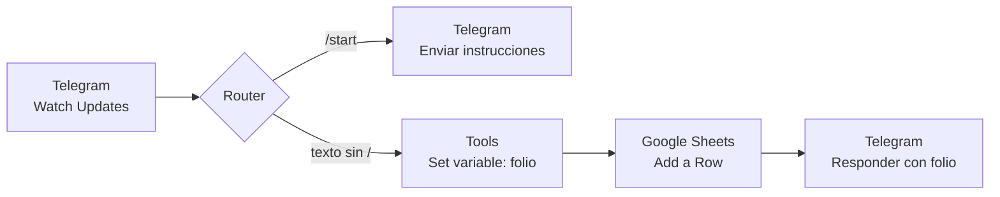

<h1 align="center">🌿 Buzón Ciudadano con Folio</h1>
<p align="center"><b>Práctica 3.1-P4 · Desarrollo Sustentable (ACD-0908)</b><br>
Ingeniería en Sistemas Computacionales · TecNM Mazatlán, Sinaloa</p>

<p align="center">
  
  
  
  
</p>

> Un bot de Telegram que funciona como **ventanilla ciudadana ambiental**: recibe reportes de la comunidad, los registra en una hoja de cálculo con fecha, usuario y estatus, y entrega al ciudadano un **folio** para dar seguimiento. Construido **sin programar**, con Make, Telegram y Google Sheets.

## 📑 Contenido

1. [Datos generales](#-datos-generales)
2. [¿Cómo funciona?](#-cómo-funciona)
3. [Blueprint del escenario Make](#-blueprint-del-escenario-make)
4. [Evidencias de funcionamiento](#-evidencias-de-funcionamiento)
5. [Preguntas de reflexión](#-preguntas-de-reflexión)
6. [Resultados y aprendizajes](#-resultados-y-aprendizajes-adquiridos)
7. [Estructura del repositorio](#-estructura-del-repositorio)

## 📋 Datos generales

| Campo | Detalle |
|---|---|
| **Asignatura** | Desarrollo Sustentable (ACD-0908) |
| **Carrera** | Ingeniería en Sistemas Computacionales |
| **Institución / Ubicación** | TecNM – Mazatlán, Sinaloa |
| **Unidad / Tema** | 3. Escenario socio-cultural · 3.1 Sociedad, organización social |
| **Práctica** | 3.1-P4 Buzón ciudadano con folio |
| **Herramientas** | Telegram (BotFather), Make, Google Sheets |
| **Bot** | `@Buzon_amBIental_bot` |
| **Zona horaria** | `America/Mazatlan` |

## 🔄 ¿Cómo funciona?



| Ruta | Condición | Acción |
|---|---|---|
| **A** | `Message → Text` es igual a `/start` | Responde con instrucciones de uso |
| **B** | `Message → Text` no empieza con `/` | Genera folio → registra fila en la hoja → responde con el folio |

**Formato del folio:** `AMB-AAMMDD-HHmmss` mediante `AMB-{{formatDate(now; "YYMMDD-HHmmss")}}`.

**Columnas de la hoja (`Reportes`):** `Folio · Fecha · Usuario · Nombre · Reporte · Estatus`

## 🧩 Blueprint del escenario Make

Archivo importable: [`blueprint/Buzon_Ciudadano_Equipo.blueprint.json`](./blueprint/Buzon_Ciudadano_Equipo.blueprint.json)

> **Notas:** la zona horaria `America/Mazatlan` se configura en el perfil de Make (no va dentro del blueprint). Las conexiones (`__IMTCONN__`), el webhook (`__IMTHOOK__`) y el ID de la hoja están en blanco o con marcador por seguridad. 🔒 **El token del bot no se incluye ni se sube a GitHub.**

<details>
<summary><b>Ver el blueprint completo (JSON)</b></summary>

```json
{
  "name": "Buzon_Ciudadano_Equipo#",
  "flow": [
    {
      "id": 1,
      "module": "telegram:WatchUpdates",
      "version": 1,
      "parameters": {
        "__IMTHOOK__": null
      },
      "mapper": {},
      "metadata": {
        "designer": {
          "x": 0,
          "y": 300,
          "name": "Watch Updates"
        }
      }
    },
    {
      "id": 2,
      "module": "builtin:BasicRouter",
      "version": 1,
      "mapper": null,
      "metadata": {
        "designer": {
          "x": 300,
          "y": 300,
          "name": "Router"
        }
      },
      "routes": [
        {
          "flow": [
            {
              "id": 3,
              "module": "telegram:SendReplyMessage",
              "version": 1,
              "parameters": {
                "__IMTCONN__": null
              },
              "filter": {
                "name": "Comando /start",
                "conditions": [
                  [
                    {
                      "a": "{{1.message.text}}",
                      "b": "/start",
                      "o": "text:equal"
                    }
                  ]
                ]
              },
              "mapper": {
                "chatId": "{{1.message.chat.id}}",
                "messageThreadId": "",
                "parseMode": "",
                "replyMarkup": "",
                "replyToMessageId": "",
                "replyMarkupAssembleType": "reply_markup_enter",
                "text": "¡Bienvenido al Buzón Ambiental!\n\nPara reportar un problema ambiental de tu colonia, envía UN mensaje con este formato:\nColonia - Problema\n\nEjemplo: Juan Carrasco - Basura acumulada en el canal de la calle principal.\n\nDescribe el lugar con calle o referencia. No incluyas datos personales de terceros (nombres, teléfonos ni domicilios exactos).\n\nRecibirás un folio para dar seguimiento a tu reporte."
              },
              "metadata": {
                "designer": {
                  "x": 600,
                  "y": 0,
                  "name": "Bienvenida /start"
                }
              }
            }
          ]
        },
        {
          "flow": [
            {
              "id": 4,
              "module": "util:SetVariable",
              "version": 1,
              "parameters": {},
              "filter": {
                "name": "Reporte (no es comando)",
                "conditions": [
                  [
                    {
                      "a": "{{1.message.text}}",
                      "b": "/",
                      "o": "text:notstartwith"
                    }
                  ]
                ]
              },
              "mapper": {
                "name": "folio",
                "scope": "roundtrip",
                "value": "AMB-{{formatDate(now; \"YYMMDD-HHmmss\")}}"
              },
              "metadata": {
                "designer": {
                  "x": 600,
                  "y": 300,
                  "name": "Set variable folio"
                },
                "interface": [
                  {
                    "name": "value",
                    "label": "folio",
                    "type": "any"
                  }
                ]
              }
            },
            {
              "id": 5,
              "module": "google-sheets:addRow",
              "version": 2,
              "parameters": {
                "__IMTCONN__": null
              },
              "mapper": {
                "mode": "select",
                "from": "drive",
                "spreadsheetId": "/<ID_HOJA_Buzon_Ciudadano_Equipo#>",
                "sheetId": "Reportes",
                "includesHeaders": true,
                "insertDataOption": "INSERT_ROWS",
                "insertUnformatted": false,
                "valueInputOption": "USER_ENTERED",
                "values": {
                  "0": "{{4.value}}",
                  "1": "{{formatDate(now; \"DD/MM/YYYY HH:mm\")}}",
                  "2": "{{1.message.from.username}}",
                  "3": "{{1.message.from.first_name}}",
                  "4": "{{1.message.text}}",
                  "5": "Recibido"
                }
              },
              "metadata": {
                "designer": {
                  "x": 900,
                  "y": 300,
                  "name": "Add a Row"
                }
              }
            },
            {
              "id": 6,
              "module": "telegram:SendReplyMessage",
              "version": 1,
              "parameters": {
                "__IMTCONN__": null
              },
              "mapper": {
                "chatId": "{{1.message.chat.id}}",
                "messageThreadId": "",
                "parseMode": "",
                "replyMarkup": "",
                "replyToMessageId": "",
                "replyMarkupAssembleType": "reply_markup_enter",
                "text": "Reporte recibido.\nTu folio es: {{4.value}}\nEstatus: Recibido\nGuarda este número para dar seguimiento a tu reporte."
              },
              "metadata": {
                "designer": {
                  "x": 1200,
                  "y": 300,
                  "name": "Respuesta con folio"
                }
              }
            }
          ]
        }
      ]
    }
  ],
  "metadata": {
    "instant": true,
    "version": 1,
    "scenario": {
      "roundtrips": 1,
      "maxErrors": 3,
      "autoCommit": true,
      "autoCommitTriggerLast": true,
      "sequential": true,
      "slots": null,
      "confidential": false,
      "dataloss": false,
      "dlq": false,
      "freshVariables": false
    },
    "designer": {
      "orphans": []
    }
  }
}
```

</details>

### Cómo reproducirlo

1. Crear la hoja `Buzon_Ciudadano_Equipo#` con la pestaña `Reportes` y los encabezados en la fila 1.
2. Crear el bot con `/newbot` en `@BotFather` y guardar el token (sin compartirlo).
3. En Make: crear el escenario, importar el blueprint y asignar la conexión de Telegram, la conexión de Google y la hoja.
4. Verificar que la zona horaria del perfil sea `America/Mazatlan`.
5. Activar el escenario (ON) y probar con `/start` y un reporte con formato `Colonia - Problema`.

## 📸 Evidencias de funcionamiento

<p align="center">
  <br>
  <sub><b>1. Creación del bot en BotFather (token oculto)</b></sub>
</p>

<p align="center">
  <br>
  <sub><b>2. Hoja Buzon_Ciudadano_Equipo#, pestaña Reportes, fila 1 con encabezados</b></sub>
</p>

<p align="center">
  <br>
  <sub><b>3. Escenario en Make: Watch Updates → Router (filtros) → Set variable → Add a Row → respuesta</b></sub>
</p>

<p align="center">
  <br>
  <sub><b>4. Chat con el bot: respuesta a /start y reporte con folio</b></sub>
</p>

<p align="center">
  <br>
  <sub><b>5. Reportes registrados con folio, fecha local, usuario, nombre y estatus</b></sub>
</p>


## 💭 Preguntas de reflexión

**1. ¿Por qué es importante que un reporte ciudadano reciba un folio? ¿Qué pasa con los reportes de palabra o en redes sociales?**
El folio convierte un mensaje en un trámite: deja constancia de qué se reportó, cuándo y quién lo hizo, y da al ciudadano un número para dar seguimiento y exigir respuesta. Sin folio no hay registro verificable ni plazo que se pueda reclamar; un reporte de palabra o una publicación en redes se pierde en el flujo de mensajes, depende de que alguien lo vea y la autoridad puede alegar que nunca lo recibió.

**2. ¿Qué organización resultó más y menos accesible?**
Por lo que revisamos en la Actividad 1, las instancias federales como PROFEPA son las más accesibles en cuanto a medios: tienen denuncia en línea, teléfono y entregan folio de la denuncia popular. Las menos accesibles suelen ser las municipales y estatales, donde el trámite depende de ir a oficina o llamar en horario de oficina, y no siempre hay formulario en línea ni folio claro. Las organizaciones civiles son cercanas y fáciles de contactar, pero no tienen facultad para sancionar, solo para canalizar o dar visibilidad. *(Ajustar con los datos exactos de la tabla de la Actividad 1.)*

**3. ¿Qué problemas ambientales se repitieron y quién debe atenderlos?**
En los reportes de prueba se repitieron la basura acumulada en calles y canales y las inundaciones por drenaje o arroyos. La basura y el drenaje corresponden primero al ayuntamiento (servicios públicos y organismo operador de agua); las afectaciones a zonas federales, costa, humedales o fauna corresponden a PROFEPA y SEMARNAT; y la autoridad ambiental estatal atiende lo que sea de competencia local. Las organizaciones civiles ayudan a documentar y presionar.

**4. ¿Quién puede quedar fuera de un buzón digital como el nuestro?**
Adultos mayores con poca familiaridad con Telegram, personas sin celular, sin datos o sin internet estable (colonias periféricas, zonas rurales), personas con discapacidad visual si el bot no es accesible, y quienes hablan lengua indígena o no leen con fluidez. Además, el bot usa un formato fijo en español. Esto afecta la equidad: reportan más quienes tienen acceso y habilidades digitales, y los problemas de las zonas más vulnerables, que suelen ser los más graves, quedan sin registrar. Un canal digital debe complementarse con ventanilla, teléfono y mensajes de voz.

**5. ¿Qué tendría que pasar para que fuera un canal formal?**
- **Receptor:** una dependencia con facultades (municipal, estatal o federal) que reciba los reportes, no solo una hoja de cálculo del equipo.
- **Responsable:** persona o área asignada por folio, con canalización a la autoridad competente.
- **Plazo:** tiempos de respuesta definidos (acuse inmediato, respuesta en un plazo legal).
- **Seguimiento:** que el ciudadano pueda consultar el estatus (`Recibido → En atención → Resuelto`) con su folio.
- **Garantías:** aviso de privacidad, protección de datos y validación de identidad cuando se requiera.

## ✅ Resultados y aprendizajes adquiridos

El bot quedó funcionando: al mandar `/start` responde con las instrucciones y cada reporte con formato `Colonia - Problema` se guarda en la hoja y me regresa su folio en segundos. Probé con reportes de mi colonia y con mensajes de otras personas, y todos se registraron con usuario, nombre, fecha en hora de Mazatlán y folio.

Lo que más me costó fue un error que no marcaba ninguna falla: las primeras pruebas respondían "Tu folio es:" vacío y dejaban la celda del folio en blanco, aunque el escenario salía en verde. Resultó que el módulo Set variable entrega el valor en el campo `value` y no con el nombre `folio`; al corregir la referencia a `{{4.value}}` ya salió. También vi que Make marca Set variable como "Deprecated", así que en un proyecto real lo cambiaría. Otra cosa fue que Telegram manda cada mensaje y hay que filtrar los comandos para no guardarlos como reportes; para eso sirvió el Router.

Aprendí a conectar un bot de Telegram con webhooks, a mapear datos entre módulos y a usar Google Sheets como base de datos sencilla, sin programar. Más allá de lo técnico, me quedó claro que el folio es lo que hace que un reporte ciudadano cuente, y que un buzón digital solo funciona si hay una autoridad que lo atienda y si llega a quienes no tienen acceso a internet. Para la gobernanza ambiental en Mazatlán, una herramienta así puede ayudar a documentar problemas como la basura y las inundaciones, pero no sustituye a las instituciones.

📄 Detalle completo de pruebas, errores y mejoras: [**RESULTADOS.md**](./RESULTADOS.md)

## 📁 Estructura del repositorio

```text
.
├── README.md
├── RESULTADOS.md
├── blueprint/
│   └── Buzon_Ciudadano_Equipo.blueprint.json
└── evidencias/
    ├── 01_botfather.png
    ├── 02_google_sheets_setup.png
    ├── 03_make_scenario.png
    ├── 04_telegram_chat.png
    └── 05_google_sheets_reportes.png
```

---
<p align="center"><sub>Práctica 3.1-P4 · Desarrollo Sustentable · TecNM Mazatlán · 2026</sub></p>
